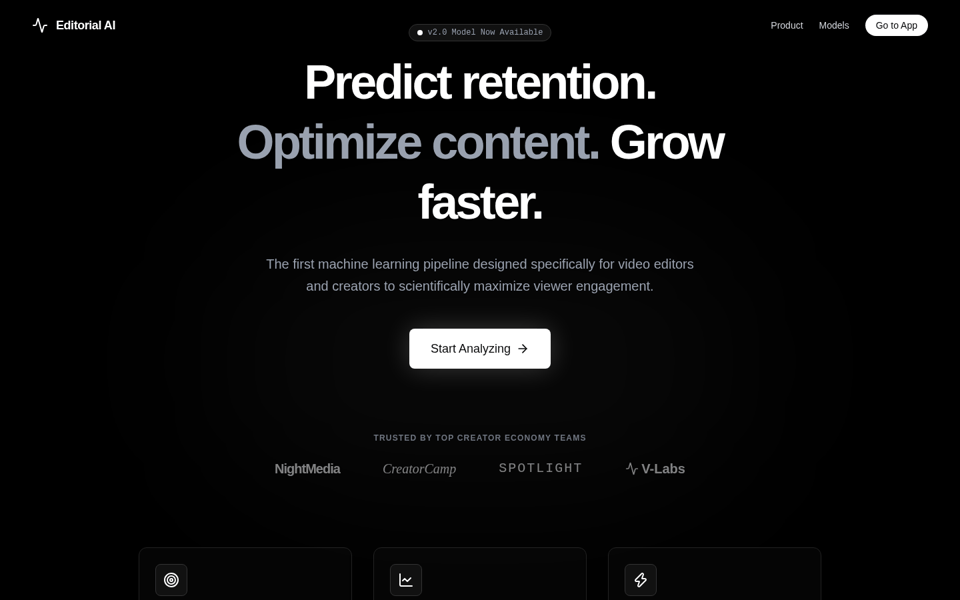
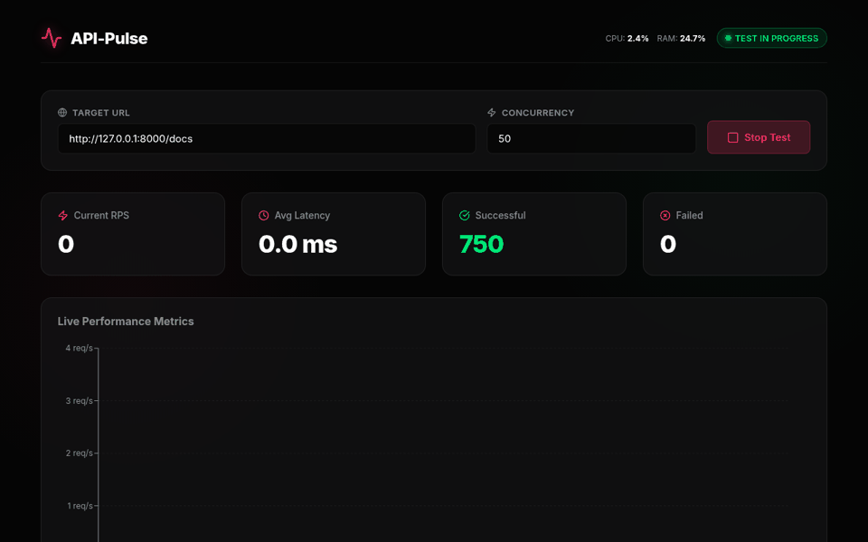
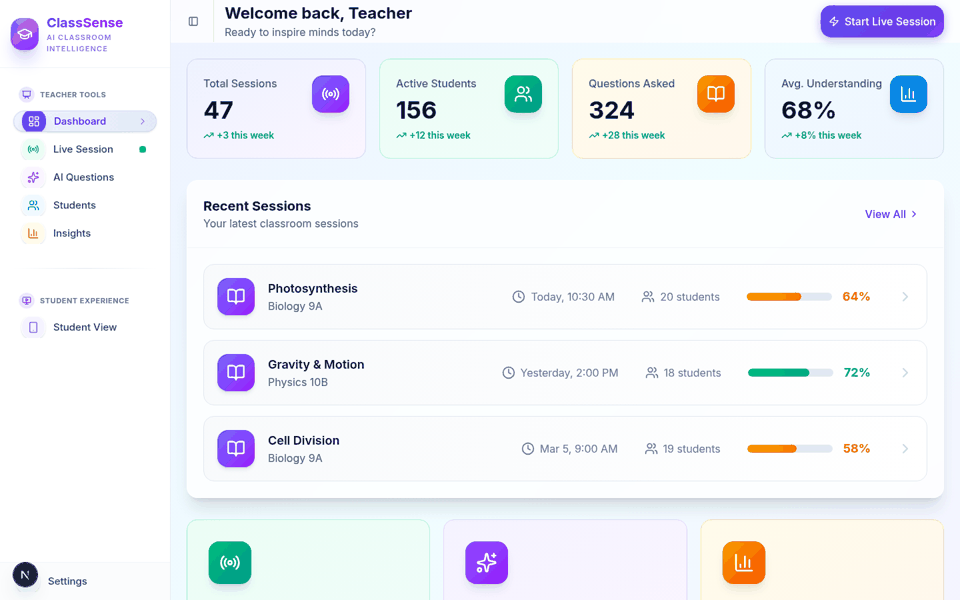
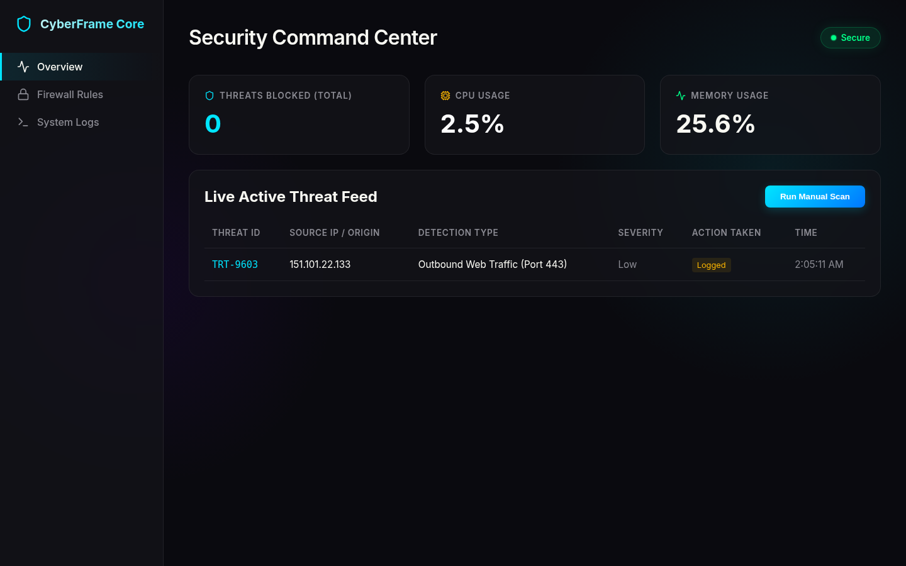
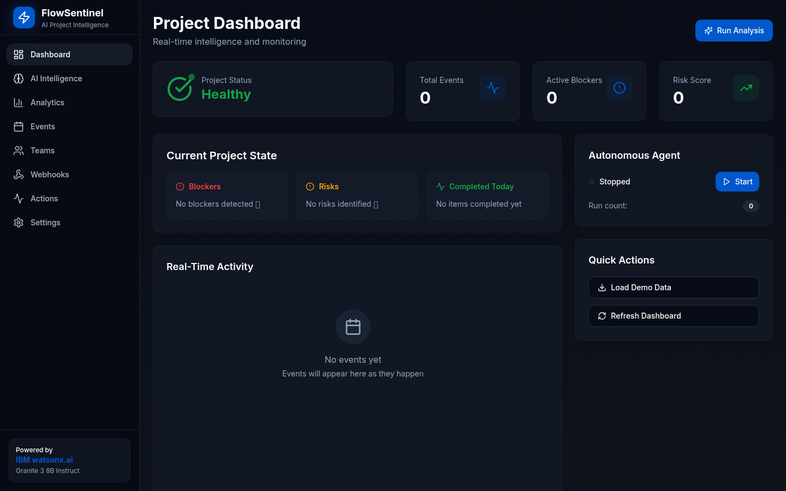
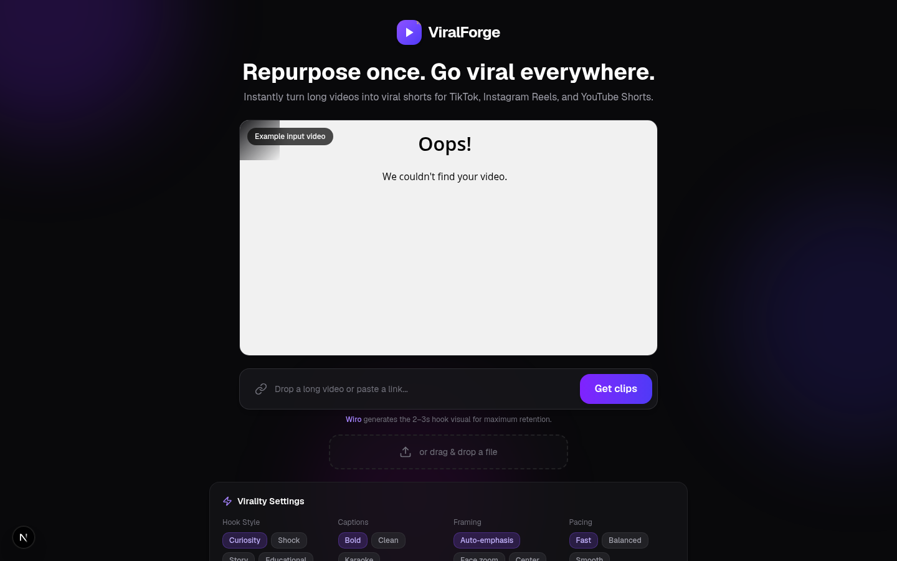

# Nabil Hassan

**AI engineer in Istanbul.** I build and fine-tune LLM systems: RAG, agents, LoRA/QLoRA, with FastAPI and React/TypeScript on top.
Final-year Management Information Systems student at Istanbul Medipol University (graduating 2027). Arabic (native), English and Turkish.

[LinkedIn](https://www.linkedin.com/in/nabil-hassan-m-003751299) · [Email](mailto:nabilhassanmohamedali@gmail.com) · Open to AI/ML internships and remote junior roles

---

## Open source: merged into [andrewyng/openworker](https://github.com/andrewyng/openworker/pull/660)

**[PR #660](https://github.com/andrewyng/openworker/pull/660): Slack "Add to Slack" dead-ends on "not signed in" for expired cloud sessions.**
Added a sign-in prompt and automatic reconnection, updated the TypeScript response types, and added frontend and backend regression tests.

## Highlights

- **Microsoft AI Innovators Program**: Artificial Intelligence Intern (Apr–Aug 2026)
- **1st place**, Agora Voice AI Hackathon Istanbul · **2nd place**, AI Impact Hackathon
- **Finalist**, Wiro AI Hackathon and Meta Llama Hackathon · Participant, IBM watsonx Agentic AI Hackathon

---

## Projects

### [Video Editorial Intelligence](https://github.com/Nabilhassan12345/video-editorial-intelligence)
Predicts hooks and viewer drop-off for short videos. DistilBERT + LoRA (0.67% of parameters trained) on 55,587 real samples, evaluated on a group-aware held-out split of 7,352 examples. React dashboard, Node backend, Azure ML workflows.

### [API-Pulse](https://github.com/Nabilhassan12345/API-Pulse)
Load-testing dashboard: FastAPI + asyncio workers stream live RPS, latency and failures over WebSockets to a React chart.

### [ClassSense](https://github.com/Nabilhassan12345/v0-class-sense-saa-s-ui)
Classroom-engagement UI for teachers: live sessions, AI-generated questions, student insights (Next.js).

| [CyberFrame Core](https://github.com/Nabilhassan12345/CyberFrame-Core) | [FlowSentinel](https://github.com/Nabilhassan12345/flowsentinel) |
|---|---|
|  |  |
| Connection-monitoring dashboard: FastAPI + psutil backend, React UI | IBM watsonx Granite agent that watches dev workflow events (watsonx hackathon) |

| [ViralForge](https://github.com/Nabilhassan12345/ViralForge-AI-Video-Repurposing-Demo) | [Resonate](https://github.com/Nabilhassan12345/resonate) |
|---|---|
|  |  |
| Long video → short clips UI (Next.js demo) | Brain-response (TRIBE v2) engagement preview for videos |

**More:** [Turkish LLM Platform](https://github.com/Nabilhassan12345/turkish-llm-platform) (QLoRA + RAG for Turkish) · [Trendbox Product Matching](https://github.com/Nabilhassan12345/trendbox-product-matching) (TF-IDF → embeddings SKU matching) · [BloomDisk](https://github.com/Nabilhassan12345/BloomDisk) (macOS disk analyzer) · [AuraOS](https://github.com/Nabilhassan12345/aura-os) (voice-agent CRM) · [FrontDesk AI](https://github.com/Nabilhassan12345/frontdesk-ai) (Voice AI Hackathon Istanbul project)

## Stack

Python · PyTorch · Hugging Face Transformers · PEFT (LoRA/QLoRA) · RAG · FastAPI · React · TypeScript · Node.js · Docker · SQL · Azure ML
